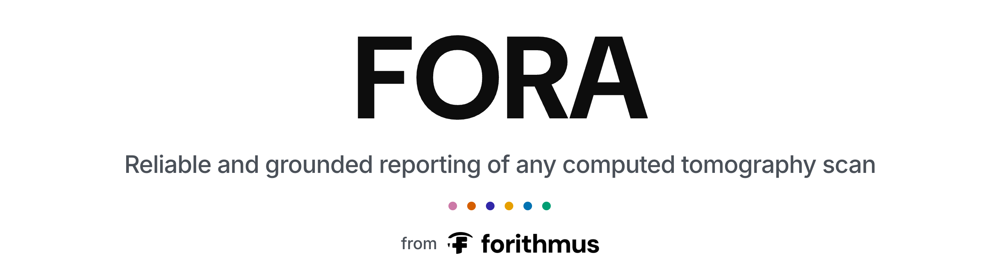
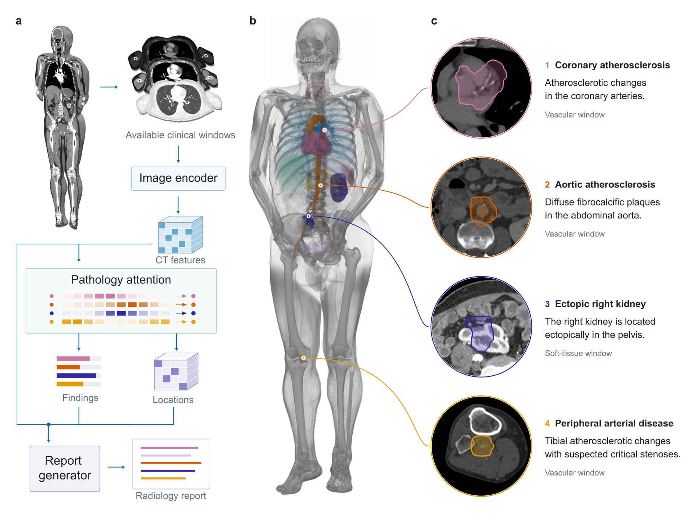
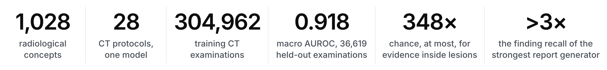
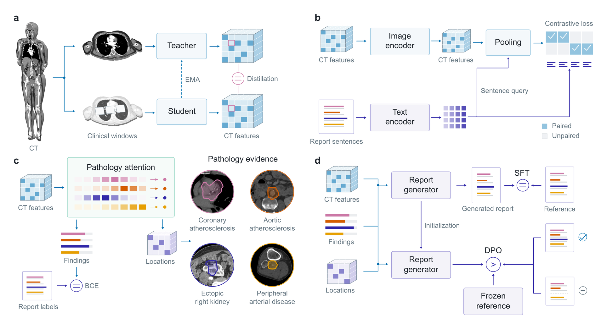
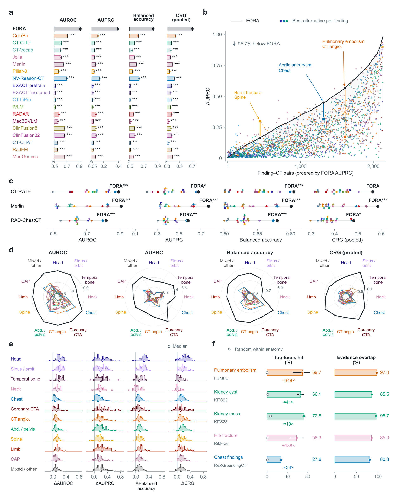
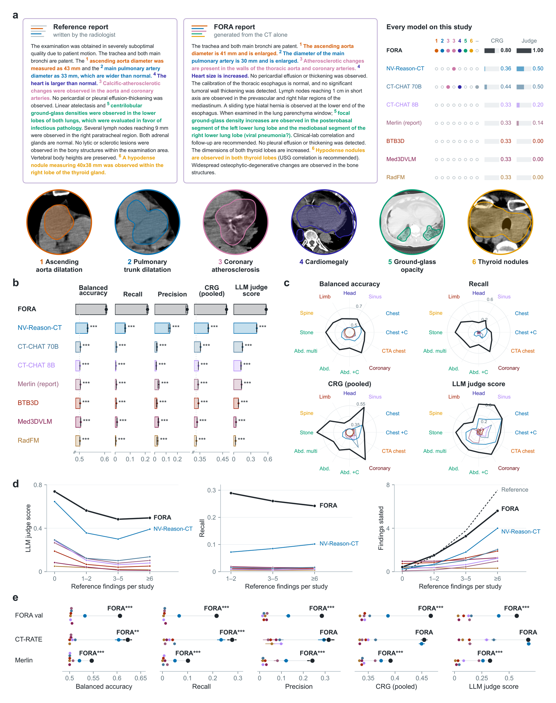
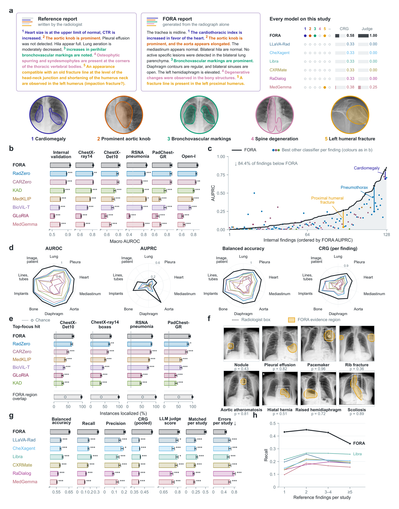
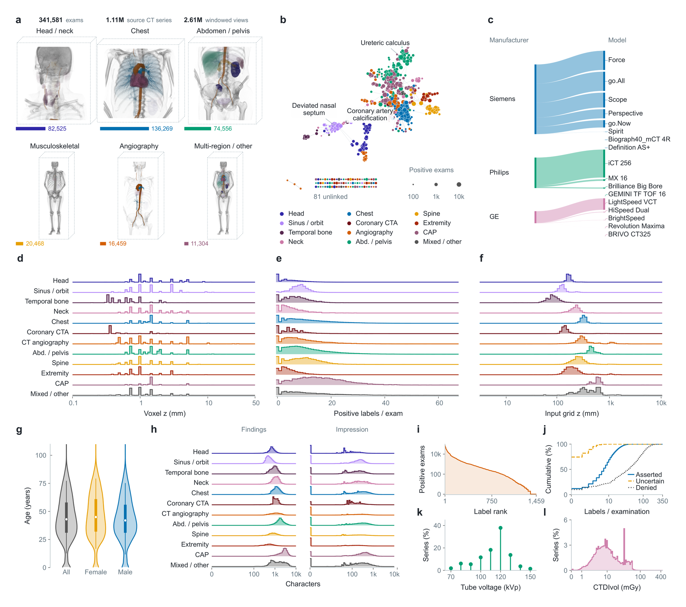

<p align="center">
  <picture>
    <source media="(prefers-color-scheme: dark)" srcset="assets/banner_dark.png">
    
  </picture>
</p>

<p align="center">
  <a href="https://arxiv.org/abs/2611.32823"></a>
  <a href="https://huggingface.co/datasets/Forithmus/FORA"></a>
  <a href="https://research.forithmus.com/"></a>
  <a href="https://litera.forithmus.com/"></a>
  <a href="https://api.forithmus.com/"></a>
</p>

This is the official code of **FORA**, a general-purpose CT model that recognizes and spatially localizes 1,028
hierarchically organized radiological findings and generates radiology reports across the 28 CT protocols of its
training cohort. A single model covers abnormalities across all anatomical regions, without separate models for
organs, diseases or examination types, and it learns to localize findings from routine reports without manually
annotated lesions. The architecture was first developed and benchmarked on chest radiographs, and the chest
radiograph model is released in the same repository.

<p align="center">
  
</p>
<p align="center"><sub><b>FORA links CT findings to spatial evidence and report text.</b> <b>a</b>, Model overview. <b>b</b>, Example CT examination showing spatial evidence for multiple findings. <b>c</b>, Image regions supporting selected findings, paired with the corresponding generated report sentences.</sub></p>

<p align="center">
  <picture>
    <source media="(prefers-color-scheme: dark)" srcset="assets/stats_dark.png">
    
  </picture>
</p>

> **Reliable and grounded reporting of any computed tomography scan with FORA**<br>
> Sezgin Er, Utku Turkbey, Alperen Gür, Omer Faruk Durugol, Suprosanna Shit, Murong Xu, Julia Wolleb, Jiayi Wang,
> Xiaoliang Wang, Hadrien Reynaud, Teodora Spasojevic, Dong Yang, Andriy Myronenko, Pengfei Guo, Yufan He, Can Zhao,
> Marc Edgar, Andreas Maier, Michael Moor, Mehmet Kemal Ozdemir, Daguang Xu, Bernhard Kainz, Bjoern Menze,
> Ibrahim Ethem Hamamci<br>
> arXiv:2611.32823, 2026 · [paper](https://arxiv.org/abs/2611.32823)

## Overview

FORA has four parts, trained in sequence on routine CT examinations and their reports.

<p align="center">
  
</p>
<p align="center"><sub><b>a</b>, Self-supervised teacher–student distillation across clinical intensity windows. <b>b</b>, Contrastive alignment of CT features with report sentences. <b>c</b>, Concept-specific attention learns finding recognition and spatial evidence from report-derived labels. <b>d</b>, Concept-guided report generation trained through supervised fine-tuning (SFT) and direct preference optimization (DPO).</sub></p>

1. **Image encoder.** A three-dimensional ViT-L trained from scratch by self-distillation across clinical intensity
   windows (DINO, iBOT and KoLeo objectives with a cross-crop patch term, then a Gram-anchoring phase).
2. **Alignment with report sentences.** The last encoder block is aligned contrastively with statements of
   presence and absence derived from each report.
3. **Organ-routed multiple-instance classifier.** Each examination is a bag of image tokens from all its series and
   intensity views. For every finding, an attention module that is routed to the finding's anatomical region scores
   the tokens, which yields a calibrated probability and spatial evidence without lesion annotations.
4. **Report generation.** A report plan lists the confident and possible findings with the location of their
   evidence, and a Gemma-4-31B writer with LoRA adapters turns the plan and the image evidence into the Findings
   section. It is trained by supervised fine-tuning and direct preference optimization.

## Results

* **Recognition.** On 36,619 held-out CT examinations, FORA achieved a macro AUROC of 0.918, exceeding the strongest of 18 existing CT
  models by 0.21. It also ranked first on three public benchmarks, including the Merlin test set (AUROC 0.907 versus 0.826).
* **Localization.** On independent benchmarks for pulmonary emboli, renal masses and rib fractures, FORA's strongest spatial evidence
  fell within annotated lesions at rates up to 348 times greater than chance, without any lesion annotation in training.
* **Report generation.** FORA achieved more than threefold higher macro-averaged finding recall than the strongest existing report
  generator.

<p align="center">
  
</p>
<p align="center"><sub><b>CT finding recognition and localization.</b> <b>a</b>, FORA and 18 comparison models on held-out CT examinations. <b>b</b>, AUPRC versus the strongest alternative across 2,132 finding-CT-type pairs. <b>c</b>, Public benchmarks. <b>d</b>, Performance across 12 CT types. <b>e</b>, AUROC advantage over the strongest alternative by CT type. <b>f</b>, Localization on four datasets.</sub></p>

<p align="center">
  
</p>
<p align="center"><sub><b>Grounded CT report generation.</b> <b>a</b>, Reference and FORA reports for a validation chest CT with matched statements numbered, and FORA's evidence. <b>b</b>, Finding-level metrics and LLM-judge score of FORA and seven other report generators. <b>c</b>, The 12 most frequent report protocols. <b>d</b>, Performance by number of reference findings per report. <b>e</b>, FORA validation set, CT-RATE and Merlin.</sub></p>

The architecture was first developed and benchmarked on chest radiographs, where it achieved state-of-the-art performance, before a
separate model was trained on three-dimensional CT examinations.

<p align="center">
  
</p>
<p align="center"><sub><b>FORA on chest radiographs.</b> <b>a</b>, Reference and FORA reports for an internal validation radiograph with matched statements numbered, and FORA's evidence. <b>b</b>, Macro AUROC on six test sets. <b>c</b>, AUPRC for 128 findings. <b>d</b>, Performance by finding category. <b>e</b>, Localization on four box-annotated test sets. <b>f</b>, Radiologist boxes and FORA's evidence on PadChest-GR. <b>g</b>, Report generation. <b>h</b>, Recall by number of reference findings.</sub></p>

## Repository structure

Each folder holds one stage of the pipeline and has its own README with inputs, outputs, commands and the
configurations that reproduce the paper.

```
FORA/
├── fora/                  shared package: geometry and windows, encoder, token caches, classifier and evidence maps,
│                          anatomical regions, labels, report-generation runtime (plan, evidence tokens, writer, decoding)
├── data-preprocessing/    CT and chest X-ray data preparation, splits, anatomical token regions, encoder token caches
├── labels/                report label extraction with Gemma-4-31B, finding hierarchy, label databases, report scoring labeler
├── encoder-pretraining/   self-supervised 3-D ViT-L (CT) and chest X-ray encoder
├── sentence-alignment/    contrastive alignment of the last encoder block with report statements
├── classifier/            organ-routed multiple-instance classifier, routing tables, calibration
├── report-generation/     report plans, evidence tokens, writer training (SFT, DPO) and decoding
├── evaluation/            finding recognition, localization and report-generation evaluation, statistics
└── inference/             end-to-end inference for CT and chest radiographs with the released models
```

| Paper section | Stage | Folder |
|---|---|---|
| 4.1 Cohort and data preparation | CT volumes, intensity views, study bags, splits | [`data-preprocessing/`](data-preprocessing) |
| 4.2 Report labels and finding hierarchy | three-pass label extraction, hierarchy, 1,028 targets | [`labels/`](labels) |
| 4.3 Image encoder | self-distillation and Gram anchoring | [`encoder-pretraining/`](encoder-pretraining) |
| 4.4 Alignment with report sentences | block-24 contrastive alignment | [`sentence-alignment/`](sentence-alignment) |
| 4.5 Organ-routed multiple-instance classifier | classifier, routing, calibration, evidence | [`classifier/`](classifier) |
| 4.6 Report generation | plan, writer, SFT, DPO, decoding | [`report-generation/`](report-generation) |
| 4.7 Chest radiograph model | the same stages for chest radiographs | each folder's chest X-ray section |
| 4.9–4.11 Evaluation | metrics, localization, report scoring, statistics | [`evaluation/`](evaluation) |
| Released models | end-to-end inference | [`inference/`](inference) |

## Installation

```bash
git clone https://github.com/forithmus/FORA.git
cd FORA
pip install -e .
```

The encoder uses the [DINOv3](https://github.com/facebookresearch/dinov3) code base, unmodified, which must be on
the Python path. Training used PyTorch 2 with FSDP on NVIDIA H200 GPUs. Label extraction, report scoring and the
LLM judge use [vLLM](https://github.com/vllm-project/vllm) with Gemma-4-31B-it. See each folder's README for
stage-specific requirements.

## Data

* **Chest radiographs.** The chest radiograph dataset used to develop and evaluate the architecture is available
  at [huggingface.co/datasets/Forithmus/FORA](https://huggingface.co/datasets/Forithmus/FORA). It contains the
  images at native resolution, reports, metadata, finding labels and the patient-level splits of the paper.
* **CT.** The FORA CT dataset is not yet fully available. Researchers can request access at
  contact@forithmus.com. To support independent benchmarking, models can be evaluated on the complete held-out
  FORA test set through [research.forithmus.com](https://research.forithmus.com/) by submitting a Docker container,
  without downloading the data.
* **Public benchmarks.** CT-RATE, the Merlin test set, RAD-ChestCT, KiTS23, RibFrac, FUMPE and ReXGroundingCT for CT,
  and RSNA Pneumonia, Open-I, ChestX-Det10, ChestX-ray14 and PadChest-GR for chest radiographs, are obtained from
  their original sources. [`evaluation/`](evaluation) documents the expected layout.

<p align="center">
  
</p>
<p align="center"><sub><b>FORA cohort and report-derived supervision across 341,581 CT examinations from 238,469 patients.</b> <b>a</b>, Examination counts by CT type. <b>b</b>, Finding co-occurrence network. <b>c</b>, Scanner manufacturers and models. <b>d–f</b>, Slice spacing, positive labels per examination and model-input extent by CT type. <b>g</b>, Patient age. <b>h</b>, Report length by CT type. <b>i</b>, Label frequencies across the 1,459 concepts in the finding hierarchy. <b>j</b>, Asserted, uncertain and denied labels per report. <b>k,l</b>, Tube voltage and volume CT dose index.</sub></p>

## Models

The trained CT and chest radiograph models are available in the `weights/` folder of
[huggingface.co/datasets/Forithmus/FORA](https://huggingface.co/datasets/Forithmus/FORA/tree/main/weights),
together with the Gemma-4 and DINOv2 models they use, so the folder runs as is. [`inference/`](inference) lists the
files each model needs and runs a study end to end, from images to finding probabilities, evidence locations and a generated report. FORA can also
be used through the API at [api.forithmus.com](https://api.forithmus.com/) and explored interactively in
[Litera](https://litera.forithmus.com/).

## Citation

If you use this code, the models or the dataset, please cite

```bibtex
@article{er2026fora,
  title   = {Reliable and grounded reporting of any computed tomography scan with FORA},
  author  = {Er, Sezgin and Turkbey, Utku and G{\"u}r, Alperen and Durugol, Omer Faruk and Shit, Suprosanna and
             Xu, Murong and Wolleb, Julia and Wang, Jiayi and Wang, Xiaoliang and Reynaud, Hadrien and
             Spasojevic, Teodora and Yang, Dong and Myronenko, Andriy and Guo, Pengfei and He, Yufan and
             Zhao, Can and Edgar, Marc and Maier, Andreas and Moor, Michael and Ozdemir, Mehmet Kemal and
             Xu, Daguang and Kainz, Bernhard and Menze, Bjoern and Hamamci, Ibrahim Ethem},
  journal = {arXiv preprint arXiv:2611.32823},
  year    = {2026}
}
```

## License

The code is released under the
[Creative Commons Attribution–NonCommercial–ShareAlike 4.0](https://creativecommons.org/licenses/by-nc-sa/4.0/)
license (see [LICENSE](LICENSE)). Third-party models and code used by FORA (DINOv3, Gemma-4, CXR-BERT, CADS) keep
their own licenses. For commercial inquiries, please contact contact@forithmus.com.
